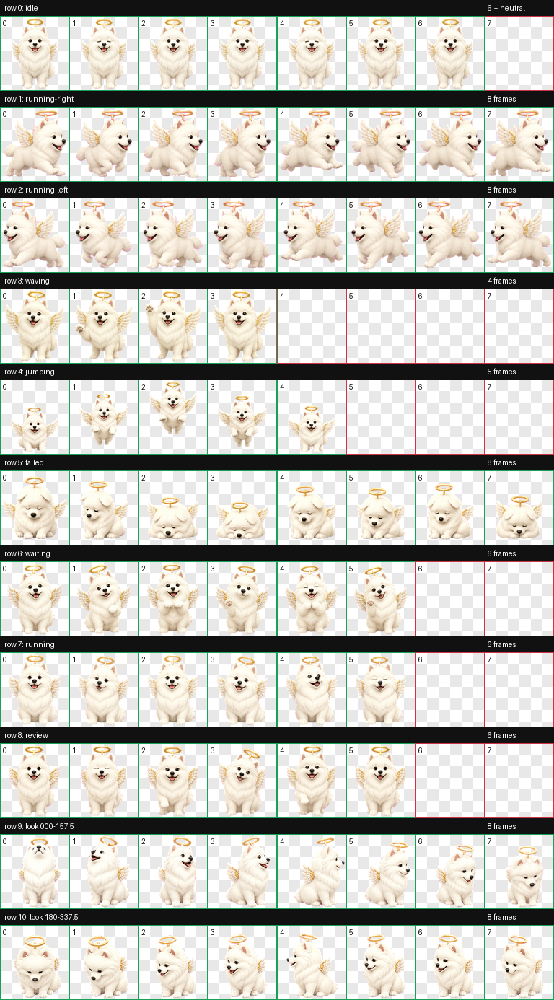
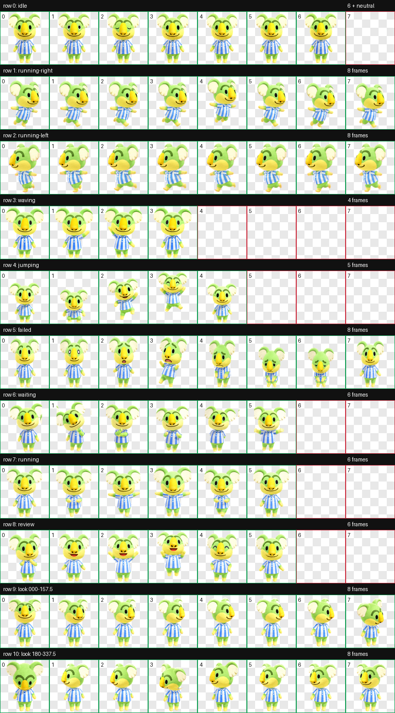
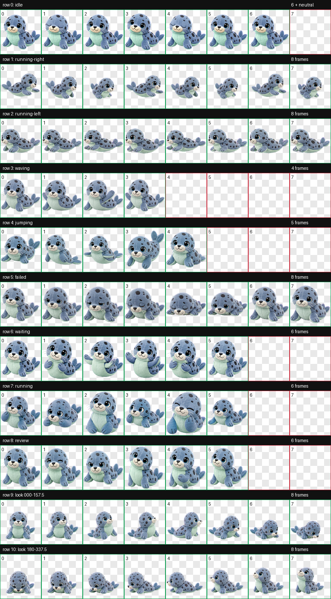

# Codex Pets

这是一个个人制作的 Codex v2 动画宠物合集，包含三只可直接安装的 pet。每只 pet 都使用 `8 × 11`、`1536 × 2288` 的透明 WebP spritesheet，并带有 9 组标准动画和 16 个环视方向。

## Pet 一览

### dogking

一只神圣又可爱的萨摩耶，拥有天使般的翅膀和金色天使环。



### Lyman

一只开朗、顽皮的绿色考拉，带着轻松的岛屿生活气息。



### Yuki

一只好奇的毛绒港海豹，为每项任务带来平静的海洋气息。



## 安装

先完全退出 Codex，然后把想要的 pet 文件夹复制到 `~/.codex/pets/`：

```bash
mkdir -p "$HOME/.codex/pets"
cp -R pets/dogking "$HOME/.codex/pets/"
cp -R pets/lyman "$HOME/.codex/pets/"
cp -R pets/yuki "$HOME/.codex/pets/"
```

重新打开 Codex 后，即可在 pet 选择界面中使用它们。若目标目录中已有同名 pet，请先自行备份。

## 仓库结构

```text
pets/<id>/
  pet.json          # Codex pet 元数据
  spritesheet.webp  # v2 动画图集
previews/<id>/
  contact-sheet.png
  look-directions.png
validation/<id>.json
```

`validation/` 保存发布前的结构验证结果。三个 spritesheet 均通过 v2 验证：`spriteVersionNumber: 2`、`8 × 11` 网格、`1536 × 2288` 尺寸，且无验证错误或警告。

## English summary

A collection of three installable Codex v2 animated pets: dogking, Lyman, and Yuki. Each package contains `pet.json` and a validated transparent `spritesheet.webp`; preview contact sheets and validation reports are included in this repository.
