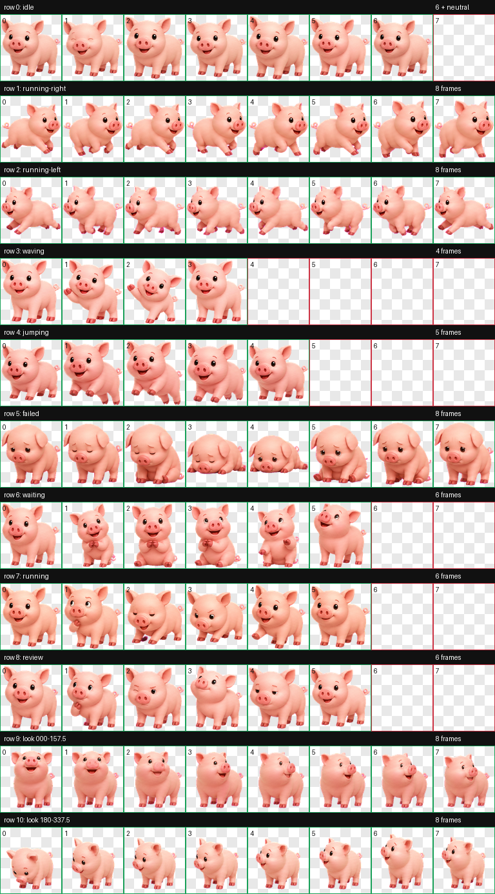

# Codex Pets

这是一个个人制作的 Codex v2 动画宠物合集，包含四只可直接安装的 pet。每只 pet 都使用 `8 × 11`、`1536 × 2288` 的透明 WebP spritesheet，并带有 9 组标准动画和 16 个环视方向。

## 🤖 让 AI agent 安装

把下面这句发给能访问网络和本机文件的 AI agent。将 `piggy` 换成 `dogking`、`lyman`、`yuki` 或「全部」即可。

> 请读取 `https://raw.githubusercontent.com/Kennyzhaoyh/codex-pets/main/AGENTS.md`，按其中的步骤在这台电脑的 Codex 桌面应用中安装 `piggy`，并核对安装结果。

完整说明见 [AGENTS.md](AGENTS.md)。

## Pet 一览

### dogking

一只神圣又可爱的萨摩耶，拥有天使般的翅膀和金色天使环。


### Lyman

一只开朗、顽皮的绿色考拉，带着轻松的岛屿生活气息。


### Yuki

一只好奇的毛绒港海豹，为每项任务带来平静的海洋气息。


### Piggy

一只圆滚滚、活泼可爱的粉色小猪。



[查看 Piggy 的 16 个环视方向](previews/piggy/look-directions.png)。

## 📦 手动安装

下载或克隆仓库后，在仓库根目录运行下面的示例来安装 `piggy`。安装其他宠物时，替换 `pet_id`。如果已设置 `CODEX_HOME`，命令会使用该目录。

```bash
pet_id=piggy
pet_root="${CODEX_HOME:-$HOME/.codex}/pets"
if [ -e "$pet_root/$pet_id" ] || [ -L "$pet_root/$pet_id" ]; then
  printf '目标已存在，请先检查或备份：%s\n' "$pet_root/$pet_id"
else
  mkdir -p "$pet_root" && cp -R "pets/$pet_id" "$pet_root/"
fi
```

在 Codex 桌面应用的宠物设置里刷新并选择已安装的宠物。如果列表还没更新，可以重启应用。

## 仓库结构

```text
pets/<id>/
  pet.json          # Codex pet 元数据
  spritesheet.webp  # v2 动画图集
previews/<id>/
  contact-sheet.png
  look-directions.png
validation/<id>.json
```

`validation/` 保存发布前的图集验证结果。四只宠物均采用 v2 格式。Piggy 保留已安装的原始图集，结构检查通过，另有 12 个边缘像素被洋红色距离检测标记，详见 [Piggy 验证报告](validation/piggy.json)。

## English summary

A collection of four installable Codex v2 animated pets: dogking, Lyman, Piggy, and Yuki. Ask a local AI agent to follow [AGENTS.md](AGENTS.md) to download, install, and verify the pets you choose.
